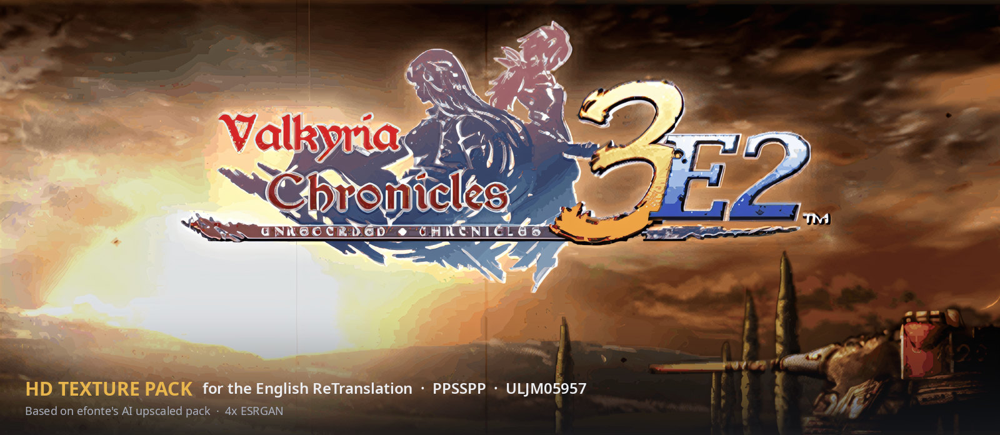
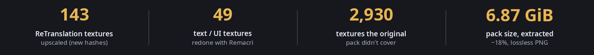
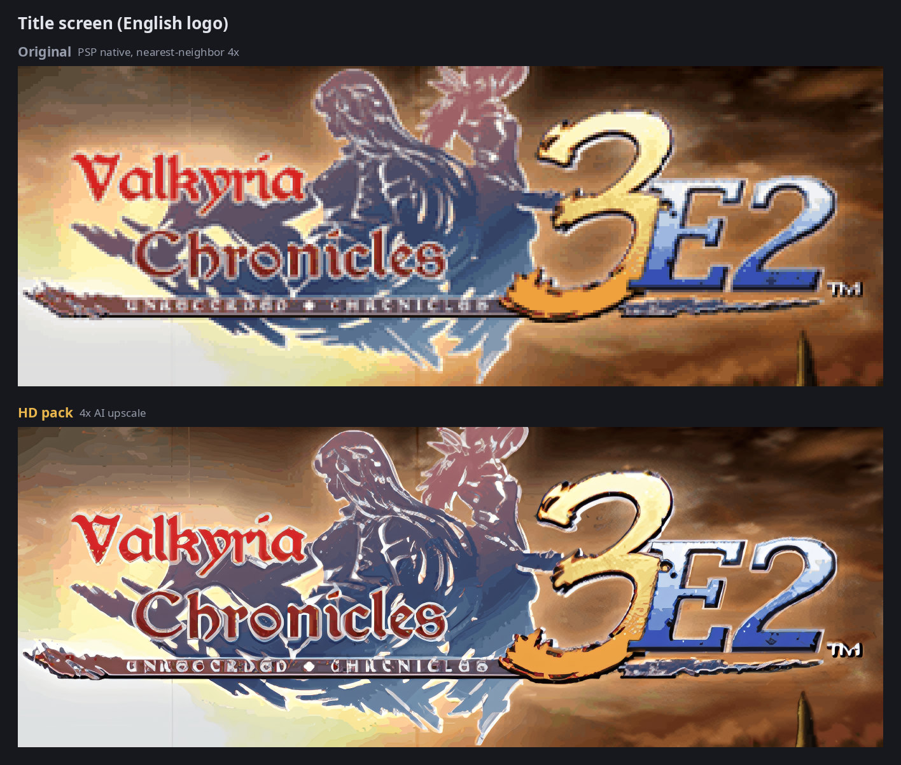
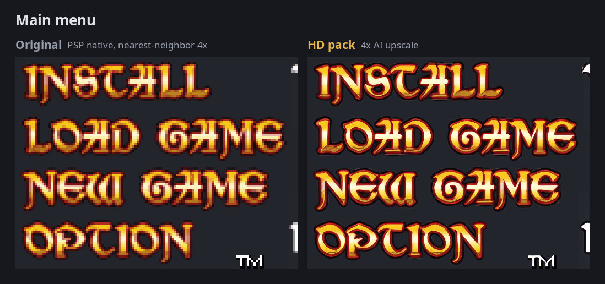
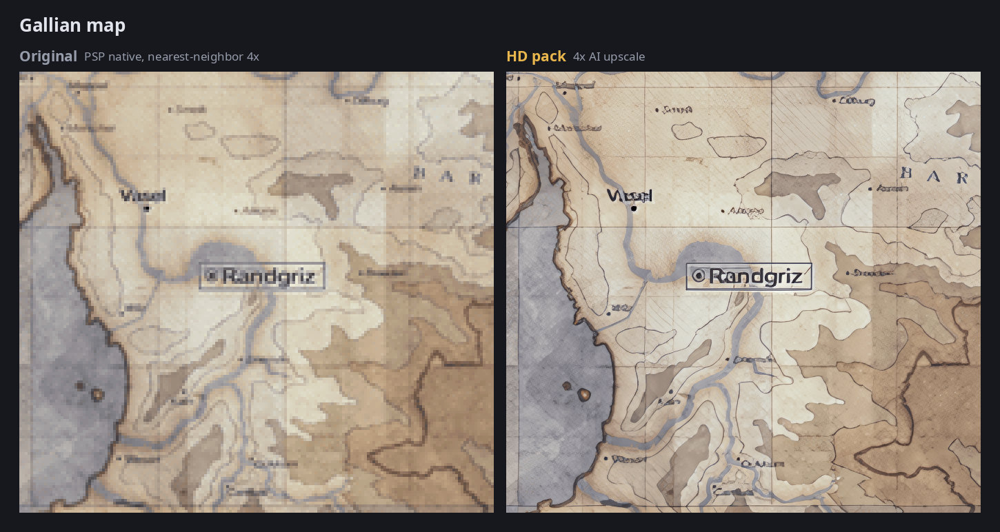
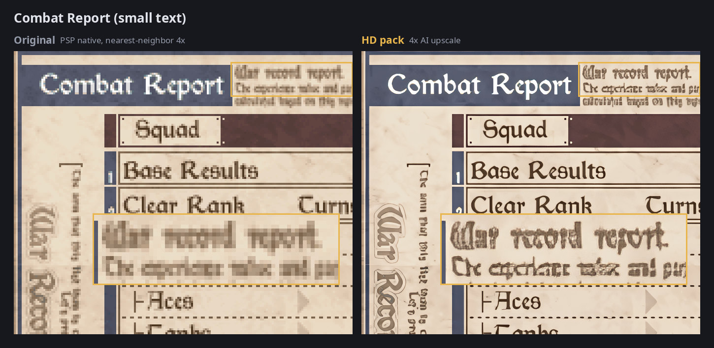
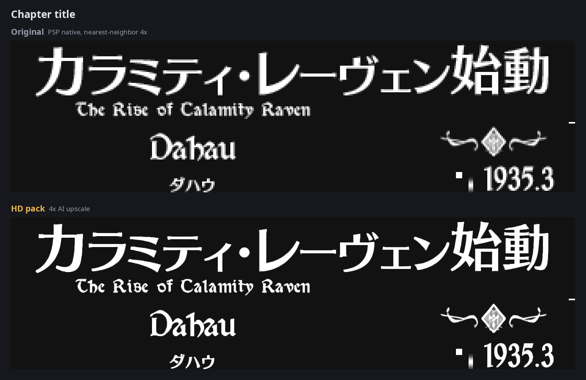
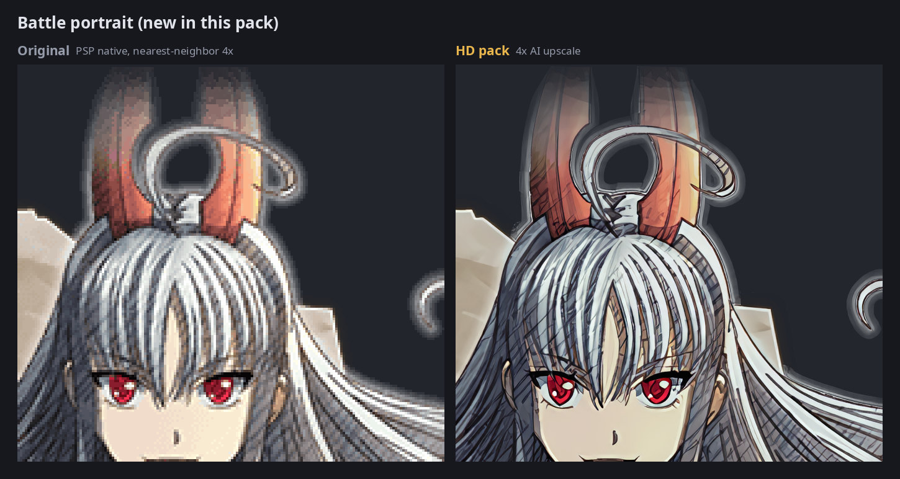
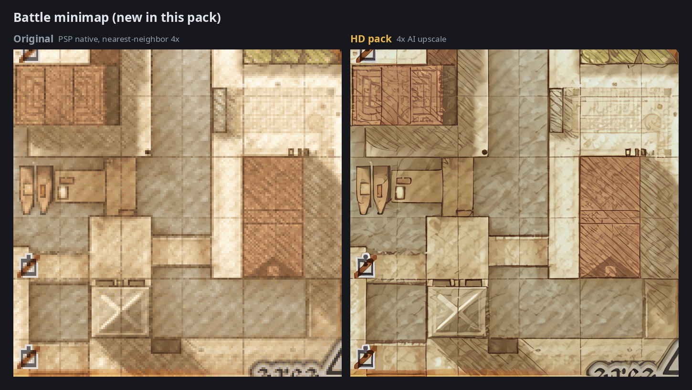
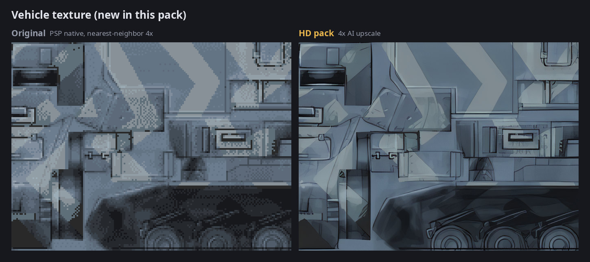

<div align="center">



# Valkyria Chronicles 3 Extra Edition: English ReTranslation-ready AI upscaled texture pack (PPSSPP)

**efonte's AI upscaled pack, extended for the [English ReTranslation](https://github.com/akorov/VC3ReTranslation) by akorov.**

[](https://github.com/steccas/vc3-ee-retranslation-hd-texture-pack/releases/tag/v1)
[](https://github.com/steccas/vc3-ee-retranslation-hd-texture-pack/releases)
[](LICENSE)
[](tools/LICENSE)
[](https://www.ppsspp.org/)
[](#install)

### [⬇ Download v1](https://github.com/steccas/vc3-ee-retranslation-hd-texture-pack/releases/tag/v1) · [Before / After](#before--after) · [Install](#install) · [Forum thread](https://forums.ppsspp.org/showthread.php?tid=26728)



</div>

A version of **efonte's AI upscaled texture pack** for *Valkyria Chronicles 3 Extra Edition*
(ULJM05957) that works with the **[English ReTranslation](https://github.com/akorov/VC3ReTranslation)** by akorov. efonte's pack
([original post](https://forums.ppsspp.org/showthread.php?tid=26728&pid=137985#pid137985)) is the base
for everything here: it was only extended, using his model and settings so the style matches.

> [!IMPORTANT]
> **Requires:** VC3 Extra Edition patched with the [English ReTranslation](https://github.com/akorov/VC3ReTranslation) **v20260625**
> ([Releases](https://github.com/akorov/VC3ReTranslation/releases)), applied to your own Japanese ISO with the scripts in that repository.

> **efonte:** if you'd rather this didn't re-host your work, or you want something changed or merged
> into your pack, just say so and it will be taken down or adjusted.

## Download

All files are on the [**Releases page (v1)**](https://github.com/steccas/vc3-ee-retranslation-hd-texture-pack/releases/tag/v1).

| Package | What's inside | File | Size |
|---|---|---|---|
| **Full pack** (ready to use) | efonte's pack + everything new + cleaned `textures.ini` | `VC3_E2_EN_texture_pack_20261002.zip`, published in 4 parts `.zip.001` … `.zip.004` | 6.82 GiB |
| **Add-on only** | only the new files + the new `textures.ini`; needs efonte's pack | [`VC3_ReTL_texture_addon.zip`](https://github.com/steccas/vc3-ee-retranslation-hd-texture-pack/releases/download/v1/VC3_ReTL_texture_addon.zip) | 1.22 GiB |

<details>
<summary><b>SHA256 checksums and exact sizes</b></summary>

| File | Bytes | SHA256 |
|---|---|---|
| `VC3_E2_EN_texture_pack_20261002.zip` (joined zip) | 7,325,142,836 | `92100028fe6589d71397402b7226a1ed2fcc4c748637062cf23095db06a1e0e9` |
| `VC3_ReTL_texture_addon.zip` | 1,310,044,070 | `a29f0b5b3885c97b7b46ea4d8bc31baddc3d8493722d3c540b0795be8bfa465e` |

`SHA256SUMS.txt` on the release page lists the checksums of the release files.

</details>

<details>
<summary><b>Joining the 4 parts of the full pack</b></summary>

The full pack is split because GitHub limits each release file to 2 GiB. Download **all four parts**
into the same folder, plus `SHA256SUMS.txt` if you want to check them, then:

- **Windows:** open `VC3_E2_EN_texture_pack_20261002.zip.001` with [7-Zip](https://www.7-zip.org/)
  and extract: 7-Zip joins the parts by itself. (Or join them first with
  `copy /b VC3_E2_EN_texture_pack_20261002.zip.001+VC3_E2_EN_texture_pack_20261002.zip.002+VC3_E2_EN_texture_pack_20261002.zip.003+VC3_E2_EN_texture_pack_20261002.zip.004 VC3_E2_EN_texture_pack_20261002.zip`.)
- **Linux / macOS:**
  ```bash
  cat VC3_E2_EN_texture_pack_20261002.zip.0* > VC3_E2_EN_texture_pack_20261002.zip
  sha256sum VC3_E2_EN_texture_pack_20261002.zip    # macOS: shasum -a 256
  # or check everything you downloaded at once:
  sha256sum -c --ignore-missing SHA256SUMS.txt
  ```
- **Android:** join the parts on a PC first (as above), then copy the joined zip or the extracted
  folder to the device.

</details>

## Before / After

Each image: **original** (the texture PPSSPP shows without this pack, native PSP resolution enlarged
4x with nearest-neighbor) vs **HD pack**, same crop.











<details>
<summary><b>More: textures the original pack didn't cover (portraits, minimaps, vehicles)</b></summary>







</details>

## What it is

| Package | Contents |
|---|---|
| **Full pack** | One ready-to-use pack for **VC3 Extra Edition (ULJM05957)** patched with the English ReTranslation (v20260625). It contains efonte's pack, the additions below and a cleaned `textures.ini`. You don't need to download efonte's pack separately. |
| **Add-on (optional)** | Only the new files plus the new `textures.ini`, for people who already have efonte's pack. |

### What's new compared to efonte's pack

- **143 textures changed by the ReTranslation**, now upscaled: title screen, main menu, Gallian map,
  chapter titles, Combat Report, deployment/battle UI, boss name plates and number fonts.
  The patch gives them new hashes, so without this they show at native resolution.
- **49 UI textures with text**, redone with a model that handles text better: LEVEL UP, FAILED,
  SUCCESS, Congratulations!, OPEN FIRE, ORDER sheets, digits, months…
- **2,930 textures the original pack didn't cover**, upscaled with efonte's model:
  - character portraits for events and battles;
  - 299 battle minimaps;
  - weapons, accessories and ground;
  - vehicles and their camo/faction palette variants.
- **Odioregistrarme's 7 hand-made HD textures** (post #3 of the thread) are included: the Gallia and
  Empire flags, the turn icons and a few small UI icons. They replace the AI versions.
- **Cleaned `textures.ini`:** 591 Spanish-only entries removed, because they never trigger with the
  English ISO. The 2 Spanish entries the English version still uses are kept.
- **Lossless PNG recompression of the whole pack, efonte's files included:** every PNG was
  recompressed with oxipng (`-o 4 --strip safe`, no alpha tricks). Each file was decoded before and
  after and checked pixel-for-pixel (RGBA): all identical, file names unchanged. The pack went from
  8.37 GiB to 6.87 GiB (−18%), so it's smaller to download and store, especially on Android.
- **Not included:** efonte's `original/` native dumps. If you want them, get them from his link in
  post #1.

## Install

> The texture folder must be named **`ULJM05957`**: that's the disc ID of the ReTranslation ISO (Extra Edition).

**Full pack**

1. Join the parts (see [Download](#download)) and extract `VC3_E2_EN_texture_pack_20261002.zip` into
   `PSP/TEXTURES/`. You should end up with `PSP/TEXTURES/ULJM05957/textures.ini`.
   If you already have a `ULJM05957` folder, remove or rename it first. Don't merge the two folders.
2. In PPSSPP, turn on **Settings → Tools → Developer tools → Texture replacement → Replace textures**.

**Add-on (if you already have efonte's pack)**

1. efonte's zip extracts to a `ULJM05781` folder. Put it in `PSP/TEXTURES/` and rename it to **`ULJM05957`**.
2. Extract the add-on into `PSP/TEXTURES/` (the archive already contains the `ULJM05957/` folder).
   Overwrite `textures.ini` when asked.
3. Optional: add Odioregistrarme's textures from post #3 (overwrite). The full pack already has them.

Tested on PPSSPP 1.20.4 (PC Linux) and Android (AYN Thor).

## Known limits

- **Dialogue font:** it's a runtime glyph cache, so it can't be precomputed. A texture upscaling shader
  in PPSSPP helps there.
- **Short palette fades/flashes:** the game generates them at runtime, so they aren't covered.
- **Untranslated Japanese text:** text the ReTranslation left in Japanese stays Japanese, just sharper.
- **DLC:** no DLC textures.
- **ReTranslation version:** made for v20260625. A later version that changes textures may need an
  update of this pack.

<details>
<summary><b>"Area 3 instead of area 4" (post #3)</b></summary>

Not reproducible on ULJM05957. It may only affect the original release, ULJM05781. If you see it on
Extra Edition, please post the texture name from "Save new textures" in the forum thread or open an issue.

</details>

## How it was made

<details>
<summary><b>Short version: offline key computation, validation, models</b></summary>

- The textures weren't dumped by playing. `DATA.BIN` was decrypted (PGD → CRI CPK/CRILAYLA → GIM,
  plus the LZ compression inside the `.PAC` files), then PPSSPP's replacement keys were computed
  offline (xxh64, `ignoreAddress`).
- **Checking the keys:**
  - against efonte's original dumps: 6,815 textures matched pixel-for-pixel, 99.6% of the ones that
    could be checked;
  - against in-game dumps on the English ISO: 25/25.
- **Main upscale:** `4x_fatal_Anime_500000_G_4x_FatalPixels_340000_G_interp_075`, efonte's exact model,
  rebuilt from the two parent models. On 150 sample textures it reproduces his output exactly.
- **Text/UI** (the 143 + 49 textures above): `4x_foolhardy_Remacri`.
- **Mapping check:** every entry of the pack was compared with the decoded game data (all 711
  map/minimap entries included). No wrong mappings and no key collisions on ULJM05957.

</details>

<details>
<summary><b>Tools: source code of the pipeline</b></summary>

The source code of the extraction, key computation, validation and upscaling pipeline is in
[`tools/`](tools/README.md):

- [`tools/keys/`](tools/keys/README.md): PGD decryption, CPK/CRILAYLA/GIM/PAC readers, offline PPSSPP
  key computation, validation and mapping checks (`run_all.sh`).
- [`tools/upscale/`](tools/upscale/README.md): the bit-exact ESRGAN upscaler, model interpolation,
  validation and the text-model comparison.

No game data, decrypted files, binaries or model weights are included. Paths are passed through
environment variables, documented in [`tools/README.md`](tools/README.md).

</details>

## Credits

| Who | For |
|---|---|
| **efonte** | the original AI upscaled pack ([post #1](https://forums.ppsspp.org/showthread.php?tid=26728&pid=137985#pid137985)); this release is built on it |
| **Odioregistrarme** | hand-made HD textures (flags, turn icons, UI icons) |
| **LunaMoo** | fonts |
| **akorov and the [VC3 ReTranslation](https://github.com/akorov/VC3ReTranslation) team** | the English ReTranslation |
| **twittman** and **foolhardy** | the ESRGAN models (4x-Fatal-Anime, 4x-Fatal-Pixels; 4x Remacri) |
| **PPSSPP** and the **libkirk** authors | the emulator, its texture replacement, PGD decryption code |
| **unknownbrackets** | file format notes |

Full list in [`CREDITS.md`](CREDITS.md).

The extraction and hashing tools and the scripts were written with the help of an AI assistant
(Claude). Everything was checked against real dumps.

## License

<details>
<summary><b>Textures CC BY-NC-SA 4.0 · tools GPL-3.0-or-later</b></summary>

- **Free and non-commercial.** The ESRGAN models used (4x-Fatal-Anime, 4x-Fatal-Pixels, 4x Remacri)
  are all CC BY-NC-SA 4.0, so the texture additions are shared under the same terms
  ([CC BY-NC-SA 4.0](https://creativecommons.org/licenses/by-nc-sa/4.0/), see [`LICENSE`](LICENSE)):
  credit the authors, no commercial use, share derivatives under the same license.
- **Everyone else's work stays theirs:** efonte's and Odioregistrarme's work belongs to them, and the
  original game artwork belongs to SEGA. The images in `docs/img/` are small crops, shown only to
  illustrate the pack.
- **Tools:** the code in `tools/` is GPL-3.0-or-later ([`tools/LICENSE`](tools/LICENSE)).

Details in [`LICENSES.md`](LICENSES.md).

</details>

## Changelog

- **v1 (2026-10-02):** first release. Full English-ready pack plus an optional add-on.
